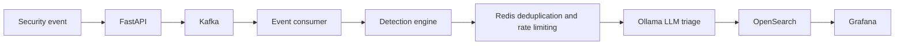

# Cybersecurity AI Pipeline

An event-driven cybersecurity prototype that ingests security events, detects common threat patterns, enriches suspicious activity with a local LLM, and stores the results for search and analysis.

> [!NOTE]
> This is an early-stage development project. The alert-evaluation route in `app/main.py` is currently a scaffold and still needs its OpenSearch client wiring before the complete API can run end to end.

## Architecture



The pipeline uses deterministic detection first and calls the LLM only for suspicious events that pass the configured rate limit.

## Features

- Typed event validation with FastAPI and Pydantic
- Kafka-based event ingestion and asynchronous processing
- Rule-based detection for brute force, prompt injection, SQL injection, and cross-site scripting patterns
- Risk scoring and vulnerability explanations
- Redis-backed event deduplication and LLM rate limiting
- Local AI triage with LangChain and Ollama
- Searchable incident records in OpenSearch
- Docker Compose environment for local development
- Avro, Protobuf, and OCSF-inspired event schema examples
- Falco and OpenTelemetry starter configurations

## Requirements

- Docker and Docker Compose
- At least 4 GB of memory available to Docker
- [Ollama](https://ollama.com/) running on the host for AI triage
- The `qwen3:8b` Ollama model, or another model configured through `OLLAMA_MODEL`

## Quick start

1. Clone the repository:

   ```bash
   git clone https://github.com/makaeron/cybersec_ai_pipeline_project.git
   cd cybersec_ai_pipeline_project
   ```

2. Pull the default local model:

   ```bash
   ollama pull qwen3:8b
   ```

3. Start the pipeline:

   ```bash
   docker compose up --build
   ```

4. Check the API:

   ```bash
   curl http://localhost:8000/health
   ```

FastAPI's interactive API documentation is available at `http://localhost:8000/docs`.

## Send a security event

Submit an event to `POST /api/events`:

```bash
curl -X POST http://localhost:8000/api/events \
  -H "Content-Type: application/json" \
  -d '{
    "event_id": "event-001",
    "timestamp": "2026-11-09T17:00:00Z",
    "source": "auth-service",
    "event_type": "failed_login",
    "user_id": "user-101",
    "ip_address": "192.168.1.25",
    "severity": "high",
    "message": "Repeated failed login attempts from the same IP",
    "metadata": {"attempts": "8"}
  }'
```

Accepted events are published to Kafka. The consumer validates and deduplicates each event, runs detection, optionally requests local LLM triage, and indexes the result in OpenSearch.

## Configuration

The sample settings are defined in `.env.example`.

| Variable | Default | Purpose |
| --- | --- | --- |
| `API_HOST` | `0.0.0.0` | FastAPI bind address |
| `API_PORT` | `8000` | FastAPI port |
| `KAFKA_BOOTSTRAP_SERVERS` | `kafka:9092` | Kafka broker address |
| `KAFKA_TOPIC` | `security-events` | Incoming event topic |
| `REDIS_HOST` | `redis` | Redis hostname |
| `REDIS_PORT` | `6379` | Redis port |
| `OPENSEARCH_HOST` | `opensearch` | OpenSearch hostname |
| `OPENSEARCH_PORT` | `9200` | OpenSearch port |
| `OPENSEARCH_INDEX` | `security-events` | Incident index name |
| `OLLAMA_BASE_URL` | `http://host.docker.internal:11434` | Ollama API URL |
| `OLLAMA_MODEL` | `qwen3:8b` | Local model used for triage |
| `LLM_RATE_LIMIT_PER_MINUTE` | `20` | Maximum triage calls per minute |

For local Python execution outside Docker, copy `.env.example` to `.env` and adjust the service hostnames to `localhost`.

## Project structure

```text
app/
  consumers/       Kafka event consumer
  routes/          FastAPI ingestion routes
  sample_data/     Example event generator
  services/        Detection, state, storage, and LLM services
configs/            OpenTelemetry collector configuration
docs/               Architecture and supporting guides
falco/              Example Falco rule
schemas/            Avro, Protobuf, and JSON event schemas
docker-compose.yml  Local service stack
Dockerfile          Python API and consumer image
```

## Development notes

Run the API directly after installing the Python dependencies:

```bash
python -m venv .venv
source .venv/bin/activate
pip install -r requirements.txt
uvicorn app.main:app --reload
```

On Windows PowerShell, activate the environment with:

```powershell
.\.venv\Scripts\Activate.ps1
```

## Security notice

This repository is a local development prototype. The Docker Compose configuration exposes development ports and disables the OpenSearch security plugin. Do not expose the stack to an untrusted network without adding authentication, TLS, network controls, secret management, and production-grade observability.

## Maintainer

`makaeron`
